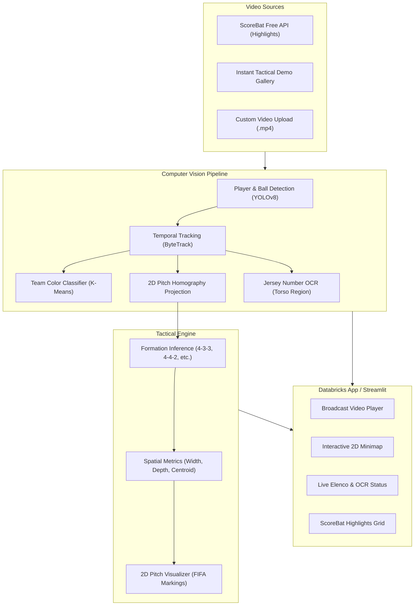

# ⚽ Football Vision Analytics

[](https://www.python.org/)
[](https://www.databricks.com/)
[](https://streamlit.io/)
[](https://ultralytics.com)
[](LICENSE)

An advanced Computer Vision and Tactical Analytics platform applied to soccer/football. Developed with **Python**, **YOLOv8**, **ByteTrack**, and a high-performance **Streamlit** dashboard natively architected for **Databricks Apps** and local execution.

---

## 🌟 Highlights & Capabilities

- 📺 **Split-Screen Match Center**: Sychronized side-by-side view combining broadcast video footage and an interactive 2D pitch radar (minimap).
- 🗺️ **2D Pitch Homography**: Translates camera perspective coordinates into standard FIFA regulation ($105m \times 68m$) top-down pitch positions.
- 🧠 **Tactical Formation Classifier**: Automatically identifies team formations (**4-3-3**, **4-4-2**, **4-2-3-1**, **3-5-2**, etc.) by spatially clustering defensive, midfield, and forward lines.
- 🔢 **High-Confidence Jersey Number OCR**: Reads player back jersey numbers using morphological contrast filtering and temporal voting. As per design standards, players with unclear or occluded numbers remain clean without false guesses.
- 🌐 **Free ScoreBat Video API Explorer**: Integrated browser to stream official match highlights and goals from the Premier League, La Liga, Champions League, Serie A, and more.
- ⚡ **Hybrid Processing**: Instant zero-latency demonstration gallery with pre-computed telemetry, plus an on-demand video processor for custom user uploads.
- ☁️ **Databricks Apps Native**: Configured with `app.yaml` for 1-click deployment on Databricks serverless compute.

---

## 🏗️ Architecture



---

## 📁 Project Structure

```
football-vision-analytics/
├── .gitignore                     # Git ignore rules
├── app.py                         # Streamlit application entrypoint (Databricks App)
├── app.yaml                       # Databricks Apps deployment manifest
├── requirements.txt               # Python package dependencies
├── README.md                      # Project documentation
├── src/
│   ├── __init__.py
│   ├── config.py                  # Pitch dimensions, thresholds, team colors
│   ├── api/
│   │   ├── __init__.py
│   │   └── scorebat.py            # Free ScoreBat Highlights API client
│   ├── vision/
│   │   ├── __init__.py
│   │   ├── detector.py            # YOLOv8 object detector
│   │   ├── tracker.py             # ByteTrack player tracking
│   │   ├── team_classifier.py     # Jersey color K-Means clustering
│   │   ├── homography.py          # Perspective homography transformer
│   │   └── number_ocr.py          # Optical character recognition on jersey backs
│   ├── tactics/
│   │   ├── __init__.py
│   │   ├── formation_detector.py  # Tactical line clustering & formation inference
│   │   └── pitch_visualizer.py    # 2D pitch renderer with FIFA geometry
│   └── pipeline.py                # Full video processing pipeline orchestrator
├── data/
│   ├── demo_matches/              # Pre-computed telemetry datasets
│   │   └── match_demo.json
│   └── videos/                    # Sample video storage
├── tests/
│   ├── test_api.py                # ScoreBat API test suite
│   └── test_tactics.py            # Tactical formation & homography test suite
└── notebooks/
    └── databricks_video_analytics.py # Batch processing notebook for Databricks clusters
```

---

## 🚀 Quickstart (Local Setup)

### 1. Clone Repository & Setup Virtual Environment
```bash
git clone https://github.com/<your-username>/football-vision-analytics.git
cd football-vision-analytics

python -m venv venv
# On Windows:
venv\Scripts\activate
# On Linux/macOS:
source venv/bin/activate
```

### 2. Install Dependencies
```bash
pip install -r requirements.txt
```

### 3. Run the Application
```bash
streamlit run app.py
```
Open [http://localhost:8501](http://localhost:8501) in your browser.

---

## ☁️ Deploying to Databricks Apps

1. In your **Databricks Workspace**, navigate to **Compute** $\rightarrow$ **Apps**.
2. Click **Create App** and name it `football-vision-analytics`.
3. Link your Git repository or sync workspace files.
4. Databricks will automatically detect `app.yaml` and install dependencies from `requirements.txt`.
5. Click **Deploy**. The app will be accessible via your Databricks Workspace URL.

---

## 🧪 Running Automated Tests

Run the full test suite with Python's built-in `unittest`:
```bash
python -m unittest discover tests
```

---

## 📤 Pushing to Your GitHub Repository

To link this local project to your personal GitHub account:

```bash
# 1. Create a new repository on GitHub named "football-vision-analytics"
# 2. Add the remote and push main:
git remote add origin https://github.com/<your-username>/football-vision-analytics.git
git branch -M main
git push -u origin main
```

---

## 📄 License
This project is licensed under the MIT License - see the LICENSE file for details.
